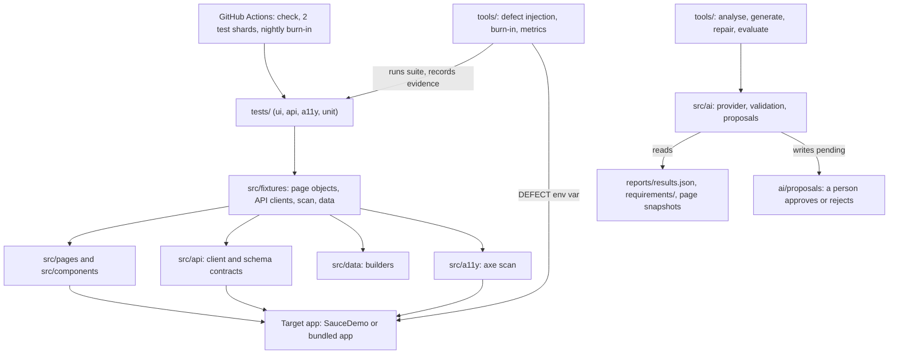

Enterprise Playwright Framework

A Playwright + TypeScript test framework with UI, API-contract and accessibility tests. It also measures
whether the tests are any good: bugs are injected into a bundled app on purpose, and the suite has to catch
them. An optional AI-assisted layer analyses failures, drafts test cases from requirements and suggests
locator repairs. It only ever produces proposals that a person reviews. The core suite runs without any AI provider.
Evidence at a glance
Every number below comes from a real run. The records are in `docs/`.
Claim Result Record
Default suite (`npm test`) 100 tests: 19 API, 18 UI, 63 unit verification log
Full suite against the bundled app (CI) the default suite plus 4 accessibility scans CI run history
Injected defects caught 16 of 16 (8 UI, 7 API, 1 accessibility) defect-injection results
Burn-in on the healthy app 45 tests x 5 runs, 0 unstable burn-in results
Burn-in can detect a flake 5 tests flagged with `flaky-login` injected flaky proof
Accessibility scan 1 critical issue found and fixed (`select-name`) findings
Bad dependency upgrade stopped TypeScript 7 blocked by CI, pinned with a reason limitations
AI failure analysis on real failures 5 failures from the `api-missing-field` defect became 5 pending proposals; 1 approved, 1 rejected by hand `ai/proposals`, method
AI test generation 3 requirements, 13 criteria, 13 test cases, none uncovered; 1 set approved and exported approved test cases, method
AI safety checks 49 unit tests cover validation, secret masking, the approval gate and no-code-execution scans ADR-004
AI evaluation scored against labelled examples, next to the rule-based baseline AI evaluation, method
Architecture



Layering rules are enforced by ESLint and by unit tests, not by convention. Tests may not import
`@playwright/test` directly and may not call `.locator()`, so selectors live only in page objects. The core
suite never imports `src/ai`, and `src/ai` may not run code or load modules dynamically.

```
config/        validated environment (zod)
src/pages/     page objects (private actions, public locators)
src/api/       typed API client and schema contracts
src/data/      test-data builders
src/a11y/      axe accessibility scan
src/reporting/ flakiness verdicts, failure classifier, run metrics
src/ai/        optional AI layer: providers, validation, proposals
src/fixtures/  the only thing tests import
target-app/    dependency-free app with injectable defects
tools/         defect-injection, burn-in, metrics and AI runners
requirements/  acceptance criteria used by test generation
evaluation/    labelled examples used to measure the AI layer
ai/proposals/  proposals from real runs, with their review status
docs/          ADRs, policies and every evidence record
```

Quick start
Requires Node 22 (see `.nvmrc`).

```
npm ci
npx playwright install chromium
copy .env.example .env
npm test
```

On macOS or Linux use `cp .env.example .env`. By default the UI tests target the public SauceDemo site.
To run everything against the bundled app instead, set `UI_BASE_URL=http://localhost:3000` in `.env`;
Playwright starts the app for you.
Commands
Command What it does
`npm run check` types, lint and formatting
`npm test` whole suite, without quarantined tests
`npm run test:smoke` / `test:api` / `test:unit` one tagged slice
`npm run test:a11y` accessibility scans (needs the bundled app as target)
`npm run test:quarantine` only quarantined tests
`npm run app` start the bundled app on port 3000
`npm run defects` inject each defect and record which are caught (about 5 minutes)
`npm run burn-in -- 10` run the suite 10 times and list unstable tests
`npm run metrics` run metrics from the last report, including AI evaluation
`npm run analyse` AI failure analysis of the last report, saved as proposals
`npm run testcases:generate -- <file>` AI test cases from a requirements file, saved as proposals
`npm run testcases:export` write approved test cases to `docs/approved-test-cases.md`
`npm run ai:repair -- --locator ... --snapshot ...` AI locator-repair suggestion, saved as a proposal
`npm run ai -- list` review proposals (`show`, `approve`, `reject`)
`npm run ai:eval` score the AI layer on the labelled examples
The AI-assisted layer
Off by default in the sense that matters: with no key, `AI_PROVIDER=offline` runs deterministic handlers on
your machine and nothing is sent anywhere. A hosted provider is used only when `AI_PROVIDER=anthropic`,
`ANTHROPIC_API_KEY` and `AI_MODEL` are set in `.env`.
Feature Input Output
Failure analysis failed tests in the Playwright report category, cause and next step, compared with the rule-based classifier
Test generation acceptance criteria plain-language test cases traced to criteria, uncovered criteria listed
Locator repair failing locator and page HTML one replacement `getBy` locator that exists in the page
Rules that hold for all three:
Provider answers are checked against a schema. Anything invalid is rejected, never repaired silently.
Evidence is cleaned before it leaves the machine: secrets masked, scripts and input values removed, size limited.
Every result is a `pending` proposal in `ai/proposals/`. A person approves or rejects it with `npm run ai`.
Approving records the decision and nothing else. No test, page object or locator is changed automatically.
Generated output is descriptions and data, never code that runs.
Quality is measured with labelled examples, and reports say whether a person has reviewed the labels.
Design decisions
Evidence over claims. A test counts only if it fails when its bug is injected. See the
defect-injection results.
Flakiness is a defect. Policy: investigate the same day, quarantine with an
owner and a 14-day limit, never retry until green.
Schema contracts for the API. Responses are checked with strict schemas, so an extra leaked field fails
the test like a missing one does.
Per-test login, no shared session. The app keeps state server-side, so a shared login would leak carts
between tests. See ADR-003.
CI tests the bundled app. A third-party outage cannot fail the build.
AI proposes, a person decides. See ADR-004.
CI
On every push and pull request: `npm run check`, then the suite in 2 parallel shards with reports and traces
uploaded. A nightly burn-in runs 10 repeats and fails on any unstable test. Dependabot opens weekly update
pull requests, and CI gates each one.
Limitations
Listed in full in `docs/limitations.md`. The main ones:
Automated accessibility scans find only part of the real problems. Keyboard use, focus order and screen-reader
wording still need manual checks.
SauceDemo is a third-party site, so its behaviour can change. The bundled app is the stable target.
The offline AI handlers are rules and templates, not a language model. The hosted provider path is covered by
unit tests with a fake network call and has never been run live in this repository, so there are no quality
numbers for a hosted model.
The AI evaluation sets are small (14 failure texts, 4 locator cases, 13 criteria). Four of the failure texts
come from real runs; the rest are typical Playwright messages. The percentages are a smoke test, not a benchmark.
Locator-repair grounding proves the suggested target exists on the page, not that it is the right element.
Review is mandatory.
