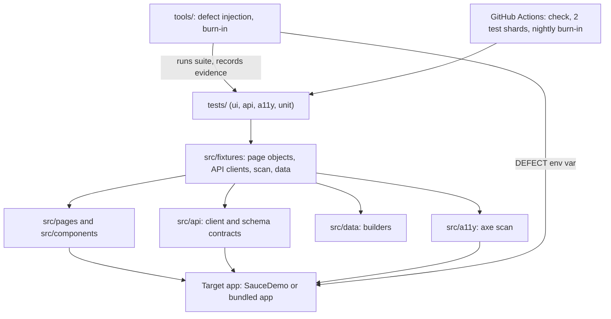

# Enterprise Playwright Framework

[](https://github.com/MANONMANISATHYA/enterprise-playwright-ai-framework/actions/workflows/ci.yaml)

A Playwright + TypeScript test framework with UI, API-contract and accessibility tests. It also measures
whether the tests are any good: bugs are injected into a bundled app on purpose, and the suite has to catch
them. The core suite runs without any AI provider.

## Evidence at a glance

Every number below comes from a real run. The records are in [`docs/`](docs).

| Claim                                   | Result                                           | Record                                                       |
| --------------------------------------- | ------------------------------------------------ | ------------------------------------------------------------ |
| Default suite (`npm test`)              | 45 tests: 19 API, 18 UI, 8 unit                  | [verification log](docs/verification-log.md)                 |
| Full suite against the bundled app (CI) | 49 tests: adds 4 accessibility scans             | CI run history                                               |
| Injected defects caught                 | 16 of 16 (8 UI, 7 API, 1 accessibility)          | [defect-injection results](docs/defect-injection-results.md) |
| Burn-in on the healthy app              | 45 tests x 5 runs, 0 unstable                    | [burn-in results](docs/burn-in-results.md)                   |
| Burn-in can detect a flake              | 5 tests flagged with `flaky-login` injected      | [flaky proof](docs/burn-in-flaky-proof.md)                   |
| Accessibility scan                      | 1 critical issue found and fixed (`select-name`) | [findings](docs/accessibility-findings.md)                   |
| Bad dependency upgrade stopped          | TypeScript 7 blocked by CI, pinned with a reason | [limitations](docs/limitations.md)                           |

## Architecture



Layering rules are enforced by ESLint, not by convention. Tests may not import `@playwright/test` directly
and may not call `.locator()`, so selectors live only in page objects.

```
config/        validated environment (zod)
src/pages/     page objects (private actions, public locators)
src/api/       typed API client and schema contracts
src/data/      test-data builders
src/a11y/      axe accessibility scan
src/fixtures/  the only thing tests import
target-app/    dependency-free app with injectable defects
tools/         defect-injection and burn-in runners
docs/          ADRs, policies and every evidence record
```

## Quick start

Requires Node 22 (see `.nvmrc`).

```
npm ci
npx playwright install chromium
copy .env.example .env
npm test
```

On macOS or Linux use `cp .env.example .env`. By default the UI tests target the public SauceDemo site.
To run everything against the bundled app instead, set `UI_BASE_URL=http://localhost:3000` in `.env`;
Playwright starts the app for you.

## Commands

| Command                                         | What it does                                                     |
| ----------------------------------------------- | ---------------------------------------------------------------- |
| `npm run check`                                 | types, lint and formatting                                       |
| `npm test`                                      | whole suite, without quarantined tests                           |
| `npm run test:smoke` / `test:api` / `test:unit` | one tagged slice                                                 |
| `npm run test:a11y`                             | accessibility scans (needs the bundled app as target)            |
| `npm run test:quarantine`                       | only quarantined tests                                           |
| `npm run app`                                   | start the bundled app on port 3000                               |
| `npm run defects`                               | inject each defect and record which are caught (about 5 minutes) |
| `npm run burn-in -- 10`                         | run the suite 10 times and list unstable tests                   |

## Design decisions

- **Evidence over claims.** A test counts only if it fails when its bug is injected. See the
  [defect-injection results](docs/defect-injection-results.md).
- **Flakiness is a defect.** [Policy](docs/flakiness-policy.md): investigate the same day, quarantine with an
  owner and a 14-day limit, never retry until green.
- **Schema contracts for the API.** Responses are checked with strict schemas, so an extra leaked field fails
  the test like a missing one does.
- **Per-test login, no shared session.** The app keeps state server-side, so a shared login would leak carts
  between tests. See [ADR-003](docs/adr/003-test-data-and-session-strategy.md).
- **CI tests the bundled app.** A third-party outage cannot fail the build.

## CI

On every push and pull request: `npm run check`, then the suite in 2 parallel shards with reports and traces
uploaded. A nightly burn-in runs 10 repeats and fails on any unstable test. Dependabot opens weekly update
pull requests, and CI gates each one.

## Limitations

Listed in full in [`docs/limitations.md`](docs/limitations.md). The main ones:

- Automated accessibility scans find only part of the real problems. Keyboard use, focus order and screen-reader
  wording still need manual checks.
- SauceDemo is a third-party site, so its behaviour can change. The bundled app is the stable target.
- The optional AI-assisted layer is planned, not built. Nothing in this repository calls an AI provider.
